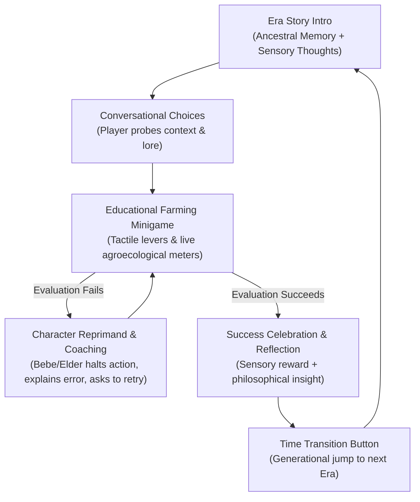

# Project Field Shift — AI Directive Manual & Generational Storyline Guide

> **Target Audience**: Any AI Assistant, System Agent, or Developer working on *Project Field Shift*.  
> **Mission**: Preserve narrative depth, scientific integrity (NASA Earth Science), emotional resonance, and interactive pedagogical excellence across generational agriculture storylines.

---

## 1. Executive Summary & Vision

*Project Field Shift* is an interactive agroecological experience that translates authoritative NASA Earth Science observations (GRACE gravimetry, POWER meteorology, SMAP soil moisture) and indigenous agricultural wisdom into an edge-to-edge, playable **Story Game**.

Rather than presenting information as passive slideshows or detached data dashboards, the user lives through a 50-year generational journey across three distinct historical eras:
1. **1990 (Past)**: Young Bebe Amarjit — The onset of synthetic urea, monoculture rice, and the preservation of biological nitrogen (*Rhizobium* legumes).
2. **2026 (Present)**: Elder Bebe Amarjit & Adult Hari — The groundwater depletion crisis, borewells coughing sand at 82m, NASA GRACE telemetry, and emergency calibration (AWD & Happy Seeder).
3. **2040 (Future)**: Dada Hari with Grandchildren Kabir & Rani — The +2.4°C climate warming scenario, delayed monsoons, seed sovereignty, and community solar drip cooperatives.

---

## 2. The Core Story Game Architecture (`Story → Game → Failure/Success → Story`)

A frequent failure mode of AI assistants is turning story prompts into passive page-turners or disjointed minigames. Any AI working on this project **must strictly adhere to the cyclical "Story Game" rhythm**:



### The 4 Mandatory Steps for Each Era:
1. **Story Introduction with Inner Monologue (`*thought*`)**:
   - Anchor the scene in physical memory (e.g., the 1920 kiln-brick well, the tarnished brass *Beej Patra* seed urn).
   - Use sensory detail: smell of parched canal silt, heat radiating from tractor hoods, taste of brass-pot well water, sound of screeching pump impellers.
   - Present interactive dialogue options that allow the player to probe the historical dilemma.
2. **Playable Agricultural Minigame**:
   - Provide concrete, tactile controls (cycling plot crops, toggling irrigation levers, selecting policy responses).
   - Display real-time telemetry (Biological Nitrogen Net, Aquifer Water Table, Pumping Strain).
3. **Interactive Failure & Coaching Loop**:
   - **Never just show a generic 'Game Over' or red error box.**
   - The matriarch/elder must personally intervene in dialogue, diagnose the agronomic breakdown (e.g., anaerobic decay from continuous flooded rice, cavitation sand-suction at 82m, debt exposure from proprietary hybrids), and command the player to try again.
4. **Success Reflection & Memory Bridge**:
   - The characters inspect the physical evidence of success (e.g., breaking open a moong root nodule to reveal red leghemoglobin, watching clear water gush at 63m, pouring a cup of water into the dry ancestral well).
   - Conclude with a generational pledge before moving forward in time.

---

## 3. Visual & Spatial Directives (Preventing "Flying" Characters)

When rendering high-resolution 2D visual assets on the web:

1. **Edge-to-Edge Full-Screen Backgrounds**:
   - Container must be `position: fixed; inset: 0; width: 100vw; height: 100vh; z-index: 9999;`.
   - Scenic backgrounds must use `object-fit: cover; object-position: center; width: 100%; height: 100%;`.
   - Apply a subtle radial and vertical gradient vignette to ensure floating cards remain readable against high-contrast skies.

2. **Grounded Character Positioning**:
   - **Rule**: Do NOT render character sprites inside floating SVGs or top-aligned headers. This causes characters to fly in the sky or get clipped at top-left.
   - **Implementation**: Place character sprites in an HTML overlay container anchored to the physical soil horizon:
     ```css
     .grounded-character-container {
       position: absolute;
       bottom: clamp(170px, 30vh, 320px);
       left: 50%;
       transform: translateX(-50%);
       z-index: 20;
       display: flex;
       justify-content: center;
       align-items: flex-end;
       pointer-events: none;
       max-height: 48vh;
     }

     .character-sprite {
       max-height: 46vh;
       width: auto;
       object-fit: contain;
       filter: drop-shadow(0 12px 24px rgba(0, 0, 0, 0.65));
       animation: gentleBob 3.5s ease-in-out infinite alternate;
     }
     ```
   - The drop shadow anchors the character's feet to the earth plane, while `gentleBob` provides organic breathing animation.

---

## 4. UI Design Rules & Constraints

Any AI modifying the user interface must respect these non-negotiable rules:

| Element | Strict Requirement | Rationale |
| :--- | :--- | :--- |
| **Emojis** | **ZERO EMOJIS ANYWHERE** | The project maintains an authentic botanical field journal aesthetic. Use clean SVGs, typography, or canvas geometries. |
| **HUD Buttons** | **Strictly Icon-Only (`←` and `↺`)** | No text labels like "Back" or "Restart" in the gameplay HUD. Only crisp 44px circular glass icon buttons. |
| **Coins in Story Mode** | **STRICTLY FORBIDDEN** | The story mode is an agroecological and human journey. Never display "Coins" or currency in the story HUD or story summary. |
| **Story Top Bar Pill** | Ecological Vitals Only | Display strictly: `Moisture % · SOM % · Nitrogen %`. |
| **Color Palette** | Botanical & Earth Tones | Backgrounds: Cream `#FAF6ED`, Forest Green `#1F3825`, Ochre Gold `#E5A93C`, Soil Rust `#7C4A2D`, Deep Dark `#0F1710`. |
| **NASA Data Location** | Exclusively in `# Info` Modal on Start Screen | Keep story mode immersive; do not clutter gameplay with floating NASA logbook popups. |

---

## 5. Scientific & Pedagogical Knowledge Base

The narrative must remain authoritative and scientifically sound:

### A. 1990: Biological Nitrogen & Soil Organic Matter (SOM)
- **Symbiotic Fixation**: Legumes (*Vigna radiata* / Moong) host *Rhizobium leguminosarum* bacteria in root nodules. They contain **leghemoglobin** (pink/red interior) that scavenges oxygen to allow nitrogenase to fix atmospheric $N_2$ gas into bioavailable ammonium ($NH_4^+$), eliminating the need for synthetic Haber-Bosch urea.
- **Taproot Bio-Drilling**: Mustard (*Brassica juncea*) taproots penetrate up to 1.5m, puncturing subsoil hardpan compaction caused by heavy tractor plowing and continuous standing water.
- **The Soil Sponge**: Every 1% increase in Soil Organic Matter (SOM) enables the soil profile to hold up to 20,000 gallons of water per acre, dampening drought vulnerability.

### B. 2026: Groundwater Stress & Tubewell Mechanics
- **NASA GRACE (Gravity Recovery and Climate Experiment)**: Twin satellites measure minute changes in Earth's gravitational field to calculate monthly mass variations, revealing subterranean groundwater loss in northwest India at **−3.2 to −4.0 cm/yr**.
- **Pump Cavitation & Sand Suction**: When regional extraction outpaces aquifer recharge, the water table drops below 80m. The pump draws air and silt, causing violent impeller vibration, cavitation pitting, and electrical motor burnout ($1,200+ replacement cost).
- **Alternate Wetting and Drying (AWD)**: Intermittent flooding (allowing water to recede 2–3 days between waterings) oxygenates the rhizosphere, reduces methane emissions by 40%, and cuts irrigation volume by 30–38% without yield loss.
- **Turbo Happy Seeder In-Situ Mulching**: Sows wheat directly into unburned rice stubble. Retains 40% more soil moisture, eliminates seasonal smog, and lowers topsoil surface temperatures by 3–5°C during pre-monsoon heatwaves.

### C. 2040: Climate Anomaly Adaptation & Sovereignty
- **NASA POWER Climate Telemetry**: Projected +2.4°C regional warming anomaly with high frequency of delayed monsoons (stalled 3–4 weeks over the ocean).
- **The Debt Trap**: Relying on single-use proprietary hybrid seeds on credit exposes smallholders to total land forfeiture if a 45-day heatwave strikes.
- **Autonomous Sovereignty**: Community seed banks preserving local landraces + cooperative solar micro-irrigation drip grids provide equitable water rationing at zero diesel fuel expense.
- **System Ethical Mandate**: *"Field Shift supports farmers and local experts. It does not replace their judgement."* (Authoritative DOCX specification).

---

## 6. Technical Guidelines for Svelte 5 & Vite

- **Svelte 5 Runes**: Always use `$state()`, `$derived()`, and `$derived.by()` for reactive state. Avoid legacy Svelte 3/4 stores (`writable`) or reactive declarations (`$:`) in new components.
- **Asset Imports in Vite**:
  ```ts
  import bg1990 from '../../assets/bg_punjab_1990.png';
  import char1990 from '../../assets/char_bebe_1990.png';
  ```
  Ensure `src/vite-env.d.ts` contains wildcard type definitions for `*.png`, `*.jpg`, and `*.svg` to prevent `svelte-check` compiler errors.
- **Node & NPM Execution**: On Windows environments, ensure commands run with `$env:PATH = "C:\Program Files\nodejs;" + $env:PATH; & "C:\Program Files\nodejs\npm.cmd"`.
- **Contracts**: Never modify files in `contracts/`. Keep simulation schemas frozen.
- **Verification Workflow**:
  1. `npm run check` (Must pass with 0 errors, 0 warnings).
  2. `npm test` (Must pass all 24 unit/simulation tests).
  3. `npm run build` (Must generate bundle in `dist/` without Rollup/Vite errors).

---

## 7. Directives for Future Prompts

When a user provides a brief request such as:
> *"make the story longer, add more memory, and if they fail have Bebe tell them to try again"*

**Do NOT:**
- Add one short sentence and declare it done.
- Re-introduce coins or emojis.
- Break the full-screen layout.
- Forget the failure loop.

**DO:**
- Deepen the sensory inner monologue (`*thought in italics*`).
- Weave physical heirloom items (e.g. the 1920 brick well, the brass *Beej Patra* urn, the soil tilak).
- Implement explicit failure states with character dialogue commands (`stage = '1990_FAIL_DIALOGUE'`).
- Immediately compile, test, and verify in the build.
